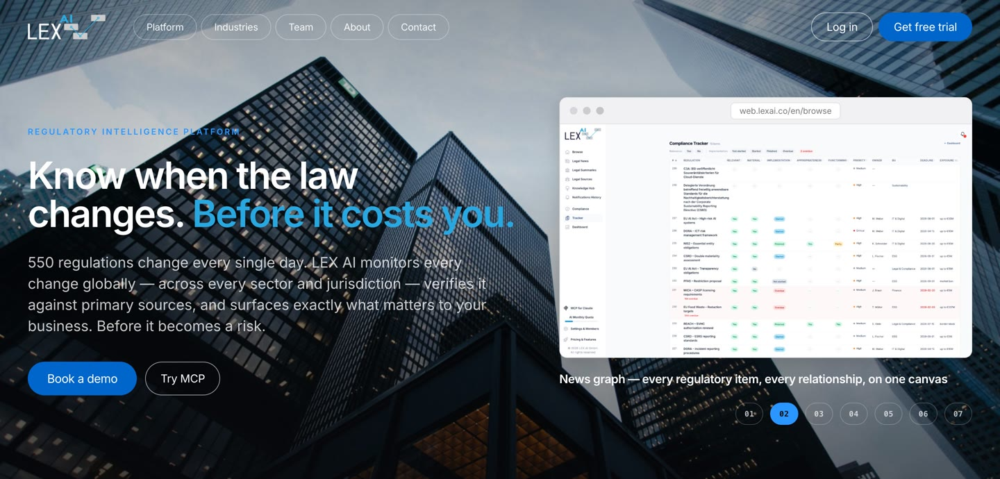

CTO & Co-founder at [LEX AI](https://lexai.co) — LegalTech compliance monitoring.
Previously Tech Lead AI at ShareChat (250M MAU), ByteDance/TikTok AI Lab R&D.

Evenings: 4K demoscene intros and gfx exe **.klos / k2** - entire demos under 4096 bytes.
2nd at Revision, 1st at Xenium, 1st at Demosplash. Meteorics nominee.

Nights: [Pill Engine](https://github.com/sp0lsh/pill-engine) — WGPU+Rust rendering core with wasm/WebGPU support.

**[Run the Pill Engine teaser realtime in your browser (WebGPU)](https://sp0lsh.github.io/Pill-Engine/)**

[Github page](https://sp0lsh.github.io/) · [Blog](https://codeklos.wordpress.com) · [LinkedIn](https://linkedin.com/in/mrmichalklos/) · [X](https://x.com/_spolsh)
